 

  

---

## 👩‍💻 About Me

I'm a software engineer building intelligent AI-powered applications and scalable systems.

I have hands-on experience with **LLM-based applications**, along with **.NET Core**, **Java**, **microservice architecture**, and **distributed systems**.

Before graduating, I gained production experience across telecom, insurance, and software companies.

---

## Technologies

- **AI & LLM engineering** — Python, LangChain, LangGraph, OpenAI API, hybrid retrieval, RAG evaluation, PyTorch
- **Backend & APIs** — FastAPI, Java / Spring Boot, C# / ASP.NET Core, EF Core, REST APIs, SignalR
- **Data & infrastructure** — PostgreSQL, Oracle SQL, Qdrant, Redis, Kafka, RabbitMQ, Celery, Docker, GitHub Actions
- **Frontend & mobile** — TypeScript, React, React Native

## Technical writing

I write about how retrieval choices affect RAG quality, how to evaluate generated answers, and when a task benefits from multiple agents. [Read my articles on Medium](https://medium.com/@iremdinc22).

---

## 🚀 Current Focus

- **RAG quality** — Testing how hybrid retrieval and reranking affect the quality of source-grounded answers.
- **Agent orchestration** — Building workflows that route tasks to specialized agents and track their execution.
- **Backend reliability** — Handling concurrent bookings and publishing events reliably with Spring Boot and PostgreSQL.

---

## 🎮 Commit Arcade

  <strong>Turning commits into power pellets.</strong> 👻

<picture>
  <source
    media="(prefers-color-scheme: dark)"
    srcset="https://raw.githubusercontent.com/iremdinc22/iremdinc22/output/pacman-contribution-graph-dark.svg"
  />
  <source
    media="(prefers-color-scheme: light)"
    srcset="https://raw.githubusercontent.com/iremdinc22/iremdinc22/output/pacman-contribution-graph.svg"
  />
  
</picture>

---

## 📊 GitHub Stats

  

---

<h3 align="center">
✨ Open to AI Engineering & Software Engineering Opportunities
</h3>

  

